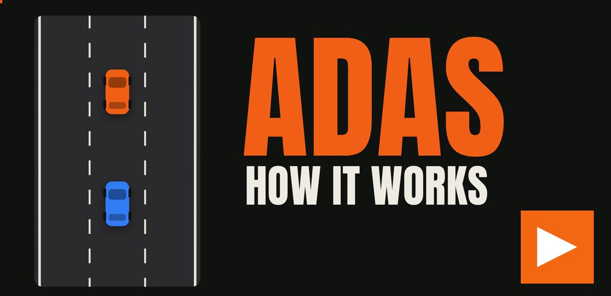

# Lane Runner

Top-down highway arcade game in C++17 and SDL2, built around a small driver-assistance stack:
simulated sensors produce object lists, a fusion step combines them, assist functions (ACC, AEB,
LKA, BSW) compute requests, and arbiters decide what reaches the vehicle. The logic runs in a fixed
20 ms cycle and is unit-tested without SDL.


## Video: how the assists work

[](https://github.com/horlesq/lane-runner/releases/tag/adas-explainer)

A 7-minute English walkthrough of the driver-assistance functions this game is built around: ACC, AEB,
LKA and BSW, the PID controller, sensors and fusion, the Kalman filter, arbitration and calibration.
Open the [release page](https://github.com/horlesq/lane-runner/releases/tag/adas-explainer) or
[download the video directly](https://github.com/horlesq/lane-runner/releases/download/adas-explainer/adas-explainer.mp4)
(1080p, 39 MB).

## Features

- **Assists:** adaptive cruise control (speed + gap PID, min-selection), automatic emergency braking
  (TTC stages with latching), lane keeping (lateral PID, rate-limited, driver override, degraded
  without lane markings), blind-spot warning with lane-change blocking, radar/camera fusion.
- **Sensors:** front radar, two rear radars and a front camera behind one `Sensor` interface. Radar
  ghosts under bridges, weak echoes from small objects, camera blinded by fog and tunnel glare,
  shorter camera range in rain.
- **Traffic:** IDM car following and MOBIL lane changes, turn signals, driver profiles (normal,
  aggressive, pickups, motorcycles), reaction times, synchronous updates from one snapshot.
- **Hazards:** roadworks with lane merges, accidents, oil, crosswind, fog, rain, tunnels, bridges.
  Layouts are randomised per run.
- **Game:** power-ups that switch assists on, near-miss combos, shields, coins, shop, garage with
  unlockable cars, persistent progress, crash cause shown on the game-over screen.

## Building

Requirements: CMake ≥ 3.16, a C++17 compiler, SDL2, SDL2_image.

### Windows (MSYS2 UCRT64)

```sh
pacman -S mingw-w64-ucrt-x86_64-gcc mingw-w64-ucrt-x86_64-cmake mingw-w64-ucrt-x86_64-ninja \
          mingw-w64-ucrt-x86_64-SDL2 mingw-w64-ucrt-x86_64-SDL2_image
cmake -B build -G Ninja
cmake --build build
./build/lane-runner.exe
```

### Linux

```sh
sudo apt install build-essential cmake ninja-build libsdl2-dev libsdl2-image-dev
cmake -B build -G Ninja
cmake --build build
./build/lane-runner
```

The asset directory is baked in at configure time (`ASSET_DIR`, pointing at `assets/` in the
source tree).

### Build options

| Option | Default | Effect |
|---|---|---|
| `HANDHELD` | `OFF` | On-screen hints name console buttons (A, B, Y) instead of keyboard keys |

```sh
cmake -B build-handheld -G Ninja -DHANDHELD=ON
```

All targets compile with `-Wall -Wextra -Wpedantic -Werror`.

## Tests

```sh
cmake --build build --target unit-tests
ctest --test-dir build --output-on-failure
```

The `unit-tests` target has no SDL dependency. It covers the PID, ACC, AEB, LKA, BSW, arbiters,
sensors and fusion, traffic behaviour (no crashes, merging at roadworks over several seeds), hazards,
power-ups, progress save/load and the crash report.

## Controls

| Key | Menu | Driving |
|---|---|---|
| Up / Down | move selection | throttle / brake |
| Left / Right | change car (garage) | steer |
| Enter / Space | confirm | – |
| Esc | back / quit | back to menu |
| Tab | – | sensor view on/off |
| A / L / B / F | – | toggle ACC / LKA / BSW / fusion while charged |

Assists switch on automatically when you drive through their power-up.

## Project layout

```
src/
  core/        Config constants, FixedVector (no-heap container), Span (non-owning view)
  world/       Vehicle, traffic (IDM/MOBIL driver model), hazards, obstacles, wind, oil, power-ups
  sensors/     Sensor interface, Radar, Camera
  perception/  Object list, lead selection, radar/camera fusion
  functions/   ACC, AEB, LKA, BSW state machines
  control/     PID template, longitudinal and steering arbiters
  game/        Progress and shop, near-miss tracking, crash report
  render/      SDL renderer, bitmap font, HUD/menu view models, control hints
  audio/       Synthesised sound effects and engine hum
  platform/    RAII wrappers for SDL init and window
  app/         main loop: input, fixed-step update, drawing
tests/         Unit tests (no SDL)
tools/         Cover and icon generator (`artwork` target, not built by default)
assets/        Sprites and generated art
```

Only `app/`, `render/`, `audio/` and `platform/` depend on SDL.

### Main loop

1. Poll input events (one-shot actions per screen).
2. Accumulate frame time and run the logic in fixed 20 ms steps:
   hazards → sensors → fusion → ACC / AEB / LKA / BSW → arbiters → ego vehicle → traffic → collisions.
3. Draw the frame from the current state.

No heap allocation happens in the cyclic part; containers have fixed capacity.

## Save data

Progress (best score, coins, upgrades, cars) is stored as `save.txt` in the SDL preference path, e.g.
`%APPDATA%\LaneRunner\LaneRunner\` on Windows and `~/.local/share/LaneRunner/LaneRunner/` on Linux.

## Credits

Sprites: [Racing Pack](https://www.kenney.nl) by Kenney, CC0.
